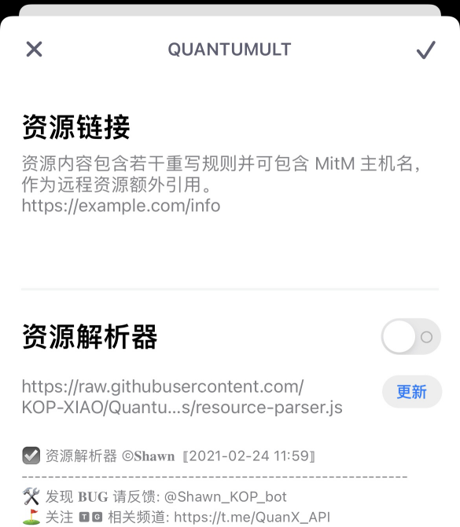

# Proxy Configs Collection

面向 Surge 与 Quantumult X 的模块、脚本、分流规则与图标集合，纯自用备份。

本仓库只做收集与整合，不维护上游脚本，也不保证可用性。所有文件按“原样”提供，使用前请自行阅读
文件内的说明与参数表。有同步需要请**自行同步，不要 fork**。

## 支持范围

- **Surge（iOS / macOS）**：模块 `surge/modules/*.sgmodule`、脚本 `surge/scripts/*.js`、分流规则 `surge/rules/*.list`；
- **Quantumult X**：重写 `quantumultx/apps_js.conf`；
- **Sub-Store**：`substore/rename.js`，节点名称与地区文案规范化脚本（同目录附测试）；
- **代理服务端**：`systemd/*.service` 单元模板（Snell、Hysteria2，Debian/Ubuntu）；
- **面板脚本**：需要较新的 Surge 版本（模块参数 `#!arguments` 需 Surge 5 及以上）；CCH、AWS Lightsail、Peekabo 面板还需要各自服务的 API Key 或 Token，仅保存在 Surge 本地模块参数中；
- 本仓库**不提供** Quantumult X 的完整配置文件和分流规则，只提供重写；
- 所有文件通过 `raw.githubusercontent.com` 直接引用，仓库不提供额外加速方式。

## 目录结构

```text
Proxy/
├── surge/
│   ├── modules/     Surge 模块（.sgmodule）
│   ├── scripts/     Surge 脚本（.js）
│   ├── rules/       分流规则（.list；legacy/ 为 2022 年遗留版本）
│   └── data/        Telegram MTProto DC 配置
├── quantumultx/     Quantumult X 重写
├── substore/        Sub-Store 脚本
├── icons/           策略组图标
├── docs/            README 引用的截图与 aiapi 面板说明
├── scripting/       iOS Scripting App 小组件项目
├── other/           其他文件
├── systemd/         服务端 systemd 单元模板
├── readme.md
├── LICENSE          MIT
└── .gitattributes   统一 LF 换行
```

## 快速开始

### Surge 模块

在 Surge → 模块 → 从 URL 安装，填入对应模块的 raw 地址：

```text
https://raw.githubusercontent.com/LucaLin233/Proxy/main/surge/modules/<模块名>.sgmodule
```

`server`、`aiapi` 模块需要参数（API Key、Token、查询间隔等），安装时按提示填写；参数说明写在模块的
`#!arguments-desc` 中，安装界面可直接看到。只需要其中一类面板时，改装对应的那一个模块即可。

### Surge 分流规则

在配置文件的 `[Rule]` 段引用：

```text
RULE-SET,https://raw.githubusercontent.com/LucaLin233/Proxy/main/surge/rules/proxy.list,PROXY
RULE-SET,https://raw.githubusercontent.com/LucaLin233/Proxy/main/surge/rules/direct.list,DIRECT
```

`proxy.list`、`direct.list`、`cdn.list` 由自建合并服务按上游规则定期更新并自动提交，**不要手工
编辑**；其余 `.list` 为手工维护。

`direct.list` 除了域名，还包含约 9 千条 IP-CIDR / IP-CIDR6 且没有 `no-resolve`。域名请求走到这一行时，
若想避免该规则集为匹配 IP 而主动解析域名，可在 RULE-SET 行末添加 `,no-resolve`。尚未解析的域名会跳过 IP 子规则；直接 IP 请求及已有解析结果的域名仍可匹配。它不等价于纯域名规则集。

### Quantumult X

```text
JS 重写     https://raw.githubusercontent.com/LucaLin233/Proxy/main/quantumultx/apps_js.conf
```

JS 重写：在“重写 → 引用”中填入链接。



使用前建议先掌握 Quantumult X 的配置导入方式：

- [Quantumult X 教程](https://www.notion.so/Quantumult-X-1d32ddc6e61c4892ad2ec5ea47f00917)（懒人可直接看第五大点的配置导入）；
- [@KOP-XIAO 的懒人配置](https://raw.githubusercontent.com/KOP-XIAO/QuantumultX/master/QuantumultX_Profiles.conf)；
- 分流规则推荐 [@blackmatrix7 的规则仓库](https://github.com/blackmatrix7/ios_rule_script)。

### Sub-Store

```text
https://raw.githubusercontent.com/LucaLin233/Proxy/main/substore/rename.js
```

脚本按国家/地区字典把节点名称统一为中文、英文全称或两位代码，并默认清理流量、到期、官网等信息节点。
在 Sub-Store 的“脚本操作”里填入链接，参数用 `#` 接在链接后面，例如 `rename.js#format=compact&name=机场名`，
完整参数表写在脚本头部注释里。

### 服务端 unit 模板

```bash
sudo cp systemd/snell.service /etc/systemd/system/
sudo systemctl daemon-reload && sudo systemctl enable --now snell
```

`snell-tun.service` 与 `hysteria2-tun.service` 以 `tun` 用户运行，适合已配置好 TUN 转发的机器；
`snell.service` 以 `nobody` 运行。ExecStart 中的二进制与配置文件路径请按实际部署修改。

### 中转站面板（CCH / CCHP）

`aiapi.sgmodule` 把 CCH、CCHP 站点的余额和 CommandCode 的限额合成一个面板，同一脚本也用于 cron 日报。
`cch_endpoints` 一站一条、竖线分隔，模式接在凭据后面（如 `:cchp`、`:user`、`:cmdcode`）。把余额源切到 CCHP 时，
用 CCHP 条目**替换**原来的主站 admin 条目，不要两条同时保留，否则同一个站会出现两行：

```text
CCHP@cchp.example.com=<管理令牌>:cchp|Clouder@cc2.example.tech=<用户 Key>:user
```

- 余额默认每个 provider 只刷新一把代表 key，并只显示它关联的单个账户（`aiapi_cchp_single_account` 默认开启）；
  一个 provider 挂多个上游账户时会少算，需要合计时把它设为 `false`。
- 行序先按 CCHP 的 key 优先级，取不到时退回脚本里写死的兜底顺序；站点末尾手写的 `:优先级` 优先。
- 面板底部的「⚠️」提示表示余额来自缓存、部分请求超时或排序信息缺失，已拿到的数据照常显示。

排序、刷新预算、CommandCode 限额行的格式与宽度、缓存和失败回退的完整规则见 [docs/aiapi-panel.md](docs/aiapi-panel.md)。

### Scripting 小组件

`scripting/` 下是三个 iOS Scripting App 的桌面小组件项目，各自的安装与配置见目录内 README：

- `scripting/aiapi/`：中转站余额与限额，对应 Surge 的 `aiapi` 面板；
- `scripting/server-overview/`：服务器流量与到期，对应 Surge 的 `server` 面板；
- `scripting/deepseek-balance/`：DeepSeek 账户余额。

前两个的数据层是 Surge 脚本的手工移植版，改动取数或排序逻辑时两边要一起改（清单见各自 README）。

## 模块一览

| 模块 | 功能 | 参数 |
| --- | --- | --- |
| `surge_status.sgmodule` | Surge 运行时长与 MITM、Rewrite、Scripting 状态；点击面板可重载配置 | 不需要 |
| `server.sgmodule` | 服务器流量与到期（Lightsail + Peekabo 合并为一个面板） | 需要，见模块内 `#!arguments-desc` |
| `aiapi.sgmodule` | CCH / CCHP 站点余额，按 CCHP 优先级排序（每轮实取，实时生效），Clouder 走 CCH | 需要，见模块内 `#!arguments-desc` |
| `app_js.sgmodule` | APP JS 重写合集：Netflix 评分与单集评分、淘票票豆瓣评分、TestFlight 账户管理、彩云天气 SVIP | 不需要 |
| `bilibili_cdn.sgmodule` | 拒绝哔哩哔哩的 PCDN / P2P 连接；其中 `DEST-PORT,3478` 和 `DOMAIN-KEYWORD,httpdns` 两条对所有 App 生效，会同时拦截所有发往 3478 端口的连接（常见的 STUN 端口）和域名含 httpdns 的请求 | 不需要 |
| `block_startup.sgmodule` | 开屏与启动广告拦截（cuttlefish 2023-01 版本快照，不再跟随上游，部分规则已失效） | 不需要 |
| `fuck_ad.sgmodule` | 常见 App 广告拦截（by ocd0711） | 不需要 |
| `get_wskey.sgmodule` | 京东 wskey 抓取；使用时先杀掉京东 App 后台再打开。抓到的 wskey 会通过 Telegram 推送，他人使用前请先阅读脚本，并在持久化存储里设置自己的 `TG_BOT_TOKEN` 和 `TG_USER_ID` | 不需要 |
| `tun_only.sgmodule` | 工作模式设为仅 VIF 接管（`compatibility-mode=3`，新版 Surge iOS 的默认值）；所有主机的 80 端口强制走 HTTP 引擎；拒绝阿里云 HTTPDNS（203.107.1.0/24），配合 B 站去广告重写使用 | 不需要 |
| `panels.sgmodule.bak` | 旧版面板模块备份（节点详情、配置重载、刷新 DNS、流媒体检测），仅供参照 | 不需要 |

## 脚本一览

| 脚本 | 用途 | 来源 |
| --- | --- | --- |
| `aiapi_relay.js` | 中转站面板：CCH / CCHP 余额与 CommandCode 限额合成一张表，按 CCHP 优先级排序；同一脚本供 cron 日报（详见 `docs/aiapi-panel.md`） | 自建 |
| `server_overview.js` | 服务器概览：AWS Lightsail 各实例流量（SigV4 直连 Lightsail `GetInstanceMetricData`）+ Peekabo 流量与到期，合并显示；同一脚本供 cron 日报 | 自建 |
| `function.js` | Surge 运行时长与功能开关状态面板，点击重载配置 | 参考 chaizia/Profiles |
| `ip_check.js` | 当前节点详情面板 | 感谢 @congcong |
| `sub_info.js` | 订阅流量面板：已用比例、剩余流量与重置天数（到期显示在脚本里已注释） | 模板来自 @mieqq |
| `reload.js` | 配置重载面板 | Author: Pysta |
| `rename.js` | 旧版节点重命名脚本，按地区字典规范化。它是 Sub-Store 脚本而不是 Surge 脚本，新配置请用 `substore/rename.js` | 感谢 @bluman / @qwerzl |
| `stream_check.js` | 奈飞、油管解锁检测 | 上游通用脚本 |
| `stream_all.js` | 流媒体全量解锁检测（YouTube、Netflix、Disney+） | 上游通用脚本 |

`server.sgmodule` 引用 `server_overview.js`，`aiapi.sgmodule` 引用 `aiapi_relay.js`，`surge_status.sgmodule` 引用 `function.js`；单独引用脚本时请与对应模块二选一，避免同一面板重复。
`ip_check.js`、`reload.js`、`stream_check.js`、`stream_all.js` 目前只被备份模块 `panels.sgmodule.bak` 引用，
需要时请在自己的配置里单独引用；`sub_info.js` 的用法和参数写在脚本头部注释里。

## 分流规则一览

| 规则 | 用途 | 维护方 |
| --- | --- | --- |
| `proxy.list` | 需要代理的域名合集（约 2 万条） | 合并服务自动提交 |
| `direct.list` | 直连合集（约 11 万条，其中约 9 千条为局域网与中国大陆 IP 段） | 合并服务自动提交 |
| `cdn.list` | CDN 优化分组 | 合并服务自动提交 |
| `telegram.list`、`telegram_ip.list`、`telegram_asn.list` | Telegram 分流（域名、IP、ASN） | 手工维护 |
| `apple_proxy.list`、`apple_proxy_rough.list`、`apple_download.list` | Apple 服务代理与下载直连 | 手工维护 |
| `emby_filter.list` | Emby 服务器分流（Surge 语法） | 手工维护 |
| `uahp_allinone.list` | 去广告、运营商劫持与隐私跟踪合集。注意开头的 Unbreak 段原本是"不要拦截"的白名单，合并进同一个规则集后会和其它条目套用同一个策略 | 手工维护 |
| `stream.list` | 流媒体域名 | 手工维护 |
| `lan.list`、`stun.list` | 局域网直连（内容与 Surge 内置的 `RULE-SET,LAN` 相同）、STUN 协议 | 手工维护 |
| `legacy/proxy.list`、`legacy/direct.list` | 2022 年遗留版本，仅存档 | 不再维护 |

`surge/rules/emby_filter.list` 覆盖的 Emby 服务器：普拉斯 AGA（中国电信可直连）、CF 公益服
（需挂代理）、普拉斯备用服（4 个）、Exflux、Nexitally/AmyTelecom（共用，仅限美国特定节点）、
Skicat、Godetia（猫熊和 3DM）。

## 图标与文档

- `icons/`：策略组图标，可直接作为 `icon-url` 引用；
- `docs/`：README 引用的 Quantumult X 操作截图，`other/` 内为其它图片。

## 功能重叠与选择

| 想要的 | 用 | 不要同时用 |
| --- | --- | --- |
| 服务器流量面板 | `server.sgmodule` | 与单独引用 `server_overview.js` 二选一 |
| AI 余额与额度面板 | `aiapi.sgmodule` | 与单独引用 `aiapi_relay.js` 二选一 |
| Surge 运行状态面板 | `surge_status.sgmodule` | 与单独引用 `function.js` 二选一 |
| 只做 APP 重写 | `app_js.sgmodule` | 与本仓库其它重写模块重复的部分 |

## 高风险与注意事项

- 本仓库只搬运和整合，**不负责维护**上游脚本，也不保证任何脚本的可用性；
- 面板脚本需要填写自己的 API Key / Token，这些参数仅保存在本地模块中，请勿提交到公开仓库；
- 在 App 内抓取 Cookie 的重写仅限自用；账号、Cookie、Token、私钥一律不要粘贴到 issue 或仓库；
- `proxy.list`、`direct.list`、`cdn.list` 由合并服务自动写回，手工编辑会被下次更新覆盖；
- 去广告类模块（`block_startup`、`fuck_ad`）会对大量域名做 MITM 解密，其中包括部分银行和微信相关域名，
  启用前请确认可以接受；
- 部分脚本依赖 Surge 的 HTTP API 或系统版本，升级 Surge 后如有失效请以官方文档为准。

## 反馈与致谢

发现编写错误或有建议欢迎提 issue；**因个人使用方式不当导致的脚本不可用，不予处理**。

脚本引用与整合过程中参考过以下作者的工作：[@sunert](https://github.com/Sunert)、
[@age174](https://github.com/age174)（招招试药）、[@NobyDa](https://github.com/NobyDa)（京东多合一签到）、
[@blackmatrix7](https://github.com/blackmatrix7)（滴滴出行系列）。京东系列脚本可配合
[Hello World 的仓库](https://github.com/JDHelloWorld/jd_scripts) 使用。

特别感谢以下脚本作者，以及整合时参考的作者（排名不分先后，如有遗漏万分抱歉，请联系我加上）：

- **脚本**：[@NobyDa](https://github.com/NobyDa)、[@chavyleung](https://github.com/chavyleung)、[@Sunert](https://github.com/Sunert)、[@lxk0301](https://github.com/lxk0301)、[@blackmatrix7](https://github.com/blackmatrix7)、[@WowYiJiu](https://github.com/WowYiJiu)、[@zhiyi](https://github.com/Ariszy)、@ziye（防止大佬再被封，故不贴出）、[@age174](https://github.com/age174)、[@yangtingxiao](https://github.com/yangtingxiao)、[@ChuheGit](https://github.com/ChuheGit)、[@zZPiglet](https://github.com/zZPiglet)、[@whyour](https://github.com/whyour)、[@mieqq](https://github.com/mieqq)、@bluman / @qwerzl；
- **配置文件**：[@KOP-XIAO](https://github.com/KOP-XIAO)；
- **分流规则**：[@blackmatrix7](https://github.com/blackmatrix7)；
- **图标**：[@shoujiqiyuan](https://github.com/shoujiqiyuan)、[@erdongchanyo](https://github.com/erdongchanyo)、[@Orz-3](https://github.com/Orz-3)、[@ChuheGit](https://github.com/ChuheGit)、@ziye（防止大佬再被封，故不贴出）。

如果这里的说明和整合的脚本对你的使用有帮助，欢迎点个 Star，感激不尽 :gift_heart:

## 许可证与免责声明

本仓库采用 [MIT License](LICENSE)。

- LucaLin233 发布的本仓库中涉及的任何解锁和解密分析脚本仅用于资源共享和学习研究，不能保证其合法性、准确性、完整性和有效性，请根据情况自行判断；
- 间接使用脚本的任何用户，包括但不限于建立 VPS 或在某些行为违反国家/地区法律或相关法规的情况下进行传播，LucaLin233 对于由此引起的任何隐私泄漏或其他后果概不负责；
- 请勿将本仓库内的任何内容用于商业或非法目的，否则后果自负；
- 如果任何单位或个人认为该项目的脚本可能涉嫌侵犯其权利，则应及时通知并提供身份证明、所有权证明，我将在收到认证文件后删除相关脚本；
- LucaLin233 对任何本仓库中包含的脚本在使用中可能出现的问题概不负责，包括但不限于由任何脚本错误导致的任何损失或损害；
- 您必须在下载后的 24 小时内从计算机或手机中完全删除以上内容；
- 任何以任何方式查看此项目的人，或直接或间接使用该项目的任何脚本的使用者，都应仔细阅读此声明。LucaLin233 保留随时更改或补充此免责声明的权利。一旦使用并复制了本仓库相关脚本或其他内容，则视为您已接受此免责声明。
